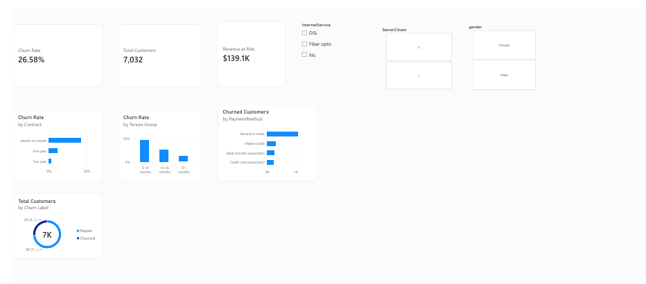

# 📊 Telco Customer Churn Analysis & Prediction

An end-to-end churn project on the IBM Telco Customer Churn dataset: a Python data-cleaning pipeline, an executive Power BI dashboard for business insights, and trained machine learning models to predict customer attrition.

[](reports/telecom_churn_powerbi_dashboard.pdf)

👉 **[📄 Click here to Download / View Full Power BI Report (PDF)](reports/telecom_churn_powerbi_dashboard.pdf)**

---

## 1. Project Overview & Business Objective

- **Goal:** Identify customers at high risk of churning early, and uncover the main drivers of attrition so retention efforts can be targeted.
- **Dataset:** IBM Telco Customer Churn, 7,043 customer records, 21 original columns.
- **Target variable:** `Churn` (`"Yes"` / `"No"`, encoded as `1` / `0`).
- **Class distribution:** about 26.5% churn (1,869) and 73.5% non-churn (5,174), a moderately imbalanced classification problem.

---

## 2. Tech Stack

- **Data Processing & Analytics:** Python (pandas, numpy, Jupyter, SQLite)
- **Business Intelligence:** Power BI (DAX, Power Query, Data Modeling)
- **Machine Learning:** scikit-learn (Logistic Regression, Random Forest, Gradient Boosting)
- **Visualization:** Matplotlib, Seaborn

---

## 3. Repository Structure

```
telco-customer-churn/
├── data/
│   ├── WA_Fn-UseC_-Telco-Customer-Churn.csv   # Raw dataset (7,043 rows x 21 cols)
│   ├── telco_churn_cleaned.csv                # Cleaned & feature-engineered dataset (7,043 x 24)
│   ├── clean.csv                              # Copy of the cleaned data
│   └── churn.db                               # SQLite database export
├── reports/
│   ├── dashboard_preview.png                  # Dashboard visual preview
│   └── telecom_churn_powerbi_dashboard.pdf    # Full Power BI executive report (PDF)
├── models/
│   └── churn_model_pipeline.joblib            # Serialized winning ML model & preprocessor
├── notebooks/
│   ├── 01_cleaning.ipynb                      # [DONE] Cleaning, validation, initial checks
│   ├── 02_eda.ipynb                           # [DONE] Exploratory data analysis & financial impact
│   └── 03_model.ipynb                         # [DONE] Machine learning modeling & evaluation
├── src/
│   └── clean.py                               # Reusable cleaning & feature engineering pipeline
├── scripts/
│   ├── build_notebook.py                      # Builds and executes cleaning notebook
│   ├── build_eda_notebook.py                  # Builds and executes EDA notebook
│   └── build_model_notebook.py                # Builds and executes ML notebook
└── README.md
```

---

## 4. Data Cleaning & Feature Engineering (`src/clean.py`, `01_cleaning.ipynb`)

**TotalCharges fix**
- The raw column was stored as a string and had 11 blank values (`' '`).
- All 11 rows have `tenure == 0` (new accounts that have not been billed yet).
- Converted to `float64` and filled these rows with `0.0`. No rows were dropped.

**Categorical normalization**
- For `OnlineSecurity`, `OnlineBackup`, `DeviceProtection`, `TechSupport`, `StreamingTV` and `StreamingMovies`, `"No internet service"` was mapped to `"No"`.
- For `MultipleLines`, `"No phone service"` was mapped to `"No"`.
- This simplifies one-hot encoding and tree-based splits.

**Target encoding**
- `Churn_Numeric`: `Yes` → 1, `No` → 0.

**Engineered features**
- `TenureGroup`: cohort bins (`0-12m`, `13-24m`, `25-48m`, `49-60m`, `60m+`).
- `TotalAddonServices`: count (0 to 6) of subscribed add-on services.
- `HasFamily`: 1 if `Partner == 'Yes'` or `Dependents == 'Yes'`, else 0.

**Output:** `data/telco_churn_cleaned.csv` with 7,043 rows × 24 columns, all original rows kept and zero nulls.

---

## 5. Power BI Dashboard

An interactive dashboard built on the Telco data.

- **KPI cards:** Churn Rate, Total Customers, Revenue at Risk.
- **Visuals:** Churn Rate by Contract, Churn Rate by Tenure Group, Churned Customers by Payment Method, and a Stayed vs Churned donut chart.
- **Slicers:** gender, InternetService, SeniorCitizen. Every card and chart updates when a slicer is used.

**DAX measures:**
- `Churn Rate`: share of customers who churned.
- `Total Customers`: count of customers.
- `Churned Customers`: count of customers with Churn Label = Churned.
- `Revenue at Risk`: sum of `MonthlyCharges` for churned customers ($139.1K).

> **Note:** The Power BI model has 7,032 customers because the 11 rows with blank `TotalCharges` were excluded there. The Python pipeline keeps all 7,043 rows (filled with 0.0). The churn rate is about 26.5% in both. Tenure groups also differ: the dashboard uses 3 groups (0-12, 13-36, 37+ months), the Python pipeline uses 5 bins.

---

## 6. Key Business Findings

| Finding | Evidence |
|---|---|
| Overall churn is about 26.6%, with about **$139K monthly revenue at risk** | Dashboard KPI cards & EDA |
| **Month-to-month** contracts churn the most (~42.7%); two-year contracts churn the least (~2.8%) | Churn Rate by Contract |
| **New customers (0-12 months)** churn the most, about 47%. Churn falls to about 6.6% after 60+ months | Tenure cohorts |
| **Electronic check** users make up the largest group of churned customers (~45.3% churn rate) | Churned Customers by Payment Method |
| **Fiber optic** customers churn at about 41.9%, well above average | InternetService slicer |
| Customers with **0 add-on services** churn at about 43%; with 4+ add-ons, under 15% | `TotalAddonServices` |

---

## 7. Machine Learning Model Benchmarks (`03_model.ipynb`)

Trained and evaluated 3 distinct model architectures with stratified 80/20 train-test split:

| Model Architecture | Accuracy | Precision | Recall (Churn) | F1-Score | ROC-AUC Score |
|---|:---:|:---:|:---:|:---:|:---:|
| **Logistic Regression (Balanced)** | 73.4% | 49.9% | **79.4%** | 0.613 | **0.842** |
| **Random Forest (Balanced)** | 75.9% | 53.1% | 78.6% | **0.634** | **0.842** |
| **Gradient Boosting** | **80.3%** | **66.2%** | 52.4% | 0.585 | 0.841 |

> **Key Modeling Takeaway**: 
> - **Logistic Regression (Class-Weighted)** achieved the highest churn **Recall (79.4%)** and top **ROC-AUC (0.842)**. In customer retention, Recall on the churn class is the priority metric, since missing a customer who is about to leave costs significantly more than a false alarm.
> - **Gradient Boosting** provided the highest overall accuracy (**80.3%**) and precision (**66.2%**).
> - Winning model pipeline serialized and saved to `models/churn_model_pipeline.joblib`.

---

## 8. Strategic Retention Recommendations

1. **Incentivize Annual Contracts**: 88% of churn comes from month-to-month contracts. Offer targeted $5-$10 bill credits at month 3 and 9 to convert customers to 1-year contracts.
2. **Support Bundling for Fiber Optic**: Fiber Optic customers have high churn (41.9%) due to premium price without support. Bundle free 3-month TechSupport and OnlineSecurity.
3. **Migrate Electronic Check Users**: Customers on Electronic Check churn at 45.3%. Provide a one-time account credit to switch to automatic payment (Credit Card / Bank Transfer).

---

## 9. How to Run

```bash
# Run the cleaning pipeline
python src/clean.py

# Rebuild and execute the notebooks
python scripts/build_notebook.py
python scripts/build_eda_notebook.py
python scripts/build_model_notebook.py
```

---

## 10. Author

**Rudra Pratap Pal**
